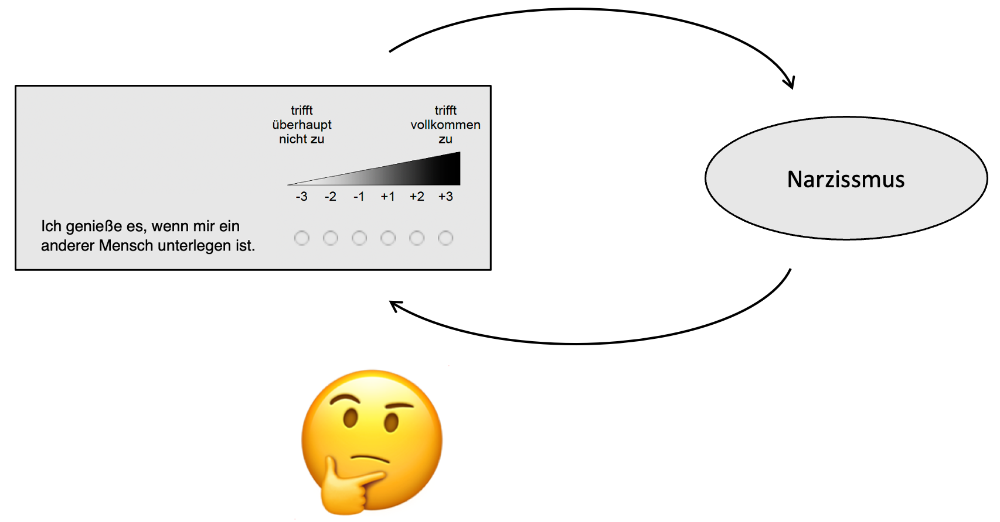
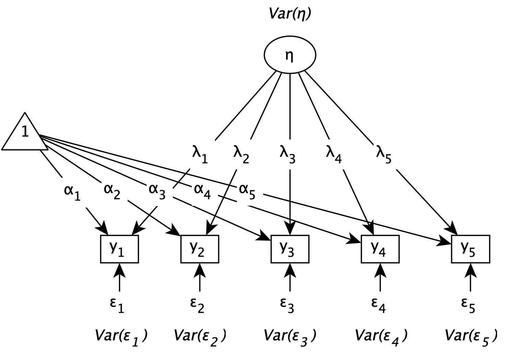
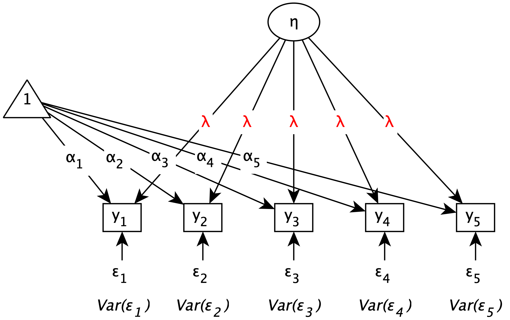
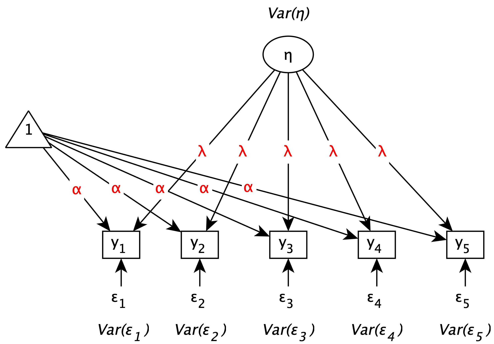
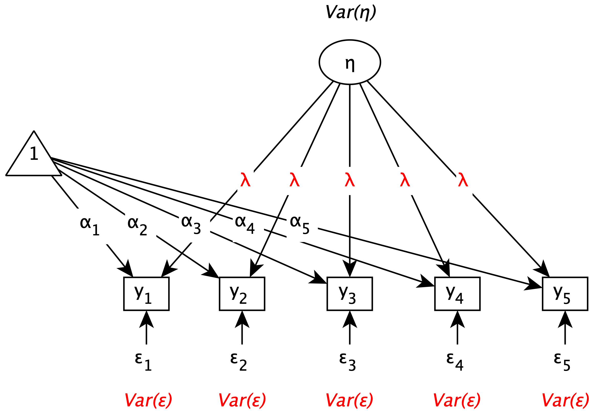
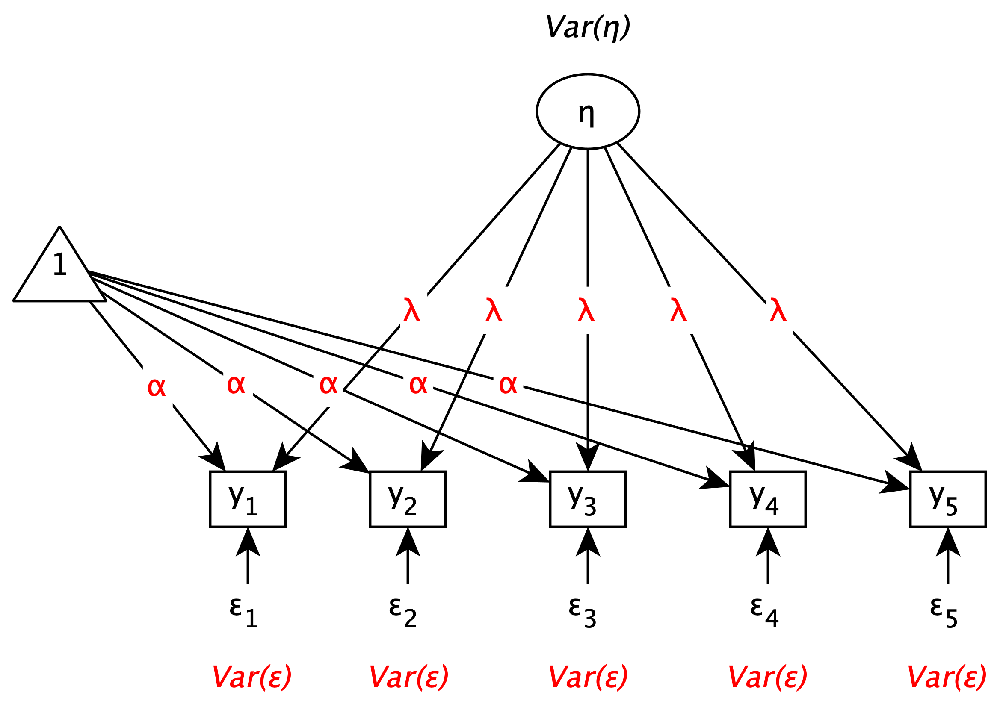

```{r}
#| label: setup
#| include: false
colors <- viridisLite::viridis(5)
dark <- "#23373b"
```

## Semesterübersicht {.smaller}

| Nr. | Datum     | Thema                                                        |
|-----|-----------|--------------------------------------------------------------|
| 1   | ab 20.10. | Rechenkompetenzen                                      |
| 2   | ab 27.10. | Gütekriterien I                                |
| 3   | ab 03.11. | Schritte der Testkonstruktion                                |
| 4   | ab 10.11. | Erstellung eines Testentwurfs                             |
|     |           | **Lektürewoche**                   |
| 5   | ab 24.11. | *Diagnostische Rechenkompetenzen I*   |
| 6   | ab 01.12. | Klassische Testtheorie                                       |
| 7   | ab 08.12. | *Item-Response-Theorie*                      |
| 8   | ab 15.12. | Exploratorische Faktorenanalyse I                            |
|     |           | **Weihnachtsferien**           |
| 9   | ab 05.01. | *Exploratorische Faktorenanalyse II*                            |
| 10  | ab 12.01. | Itemanalyse I                                                |
| 11  | ab 19.01. | Itemanalyse II, Itemselektion und Testrevision               |
| 12  | ab 26.01. | *Diagnostische Rechenkompetenzen II*                            |
| 13  | ab 02.02. | Gütekriterien II  |

# Überblick

## Themen der heutigen Sitzung

Klassische Testtheorie (KTT)

1. Grundannahmen
2. Reliabilität
3. Messmodelle

# Grundannahmen

## Wozu eine Testtheorie?

:::: {.columns}
::: {.column width="55%"}
{width=100% fig-alt="Schema zum Zusammenhang zwischen latentem Konstrukt und Messung."}
:::

::: {.column width="45%"}
- Wie hängen Messung und latentes Konstrukt zusammen?
- Welche Rolle spielen Messfehler?
- Wie kann ich einen Test-Score berechnen und interpretieren?
- Wie muss mein Test konstruiert sein?
:::
::::

## Der Ansatz der Klassischen Testtheorie

**Modell der Klassischen Testtheorie**

$$
X = T + E \tag{1}
$$

- $T$: Wahrer Wert
- $X$: Beobachtungswert, Testwert
- $E$: Fehlerkomponente, Messfehler
- Häufig ist $X$ der Summenscore von $k$ Items $i=1,\dots,k$, sodass:

$$
X = \sum_{i=1}^k x_i \tag{2}
$$

## Grundannahmen

:::: {.columns}
::: {.column width="50%"}
*Population*

- Personen sind (daraus) eine Zufallsstichprobe
- Für jede Person liegt theoretisch eine infinite Anzahl von Messergebnissen vor
:::

::: {.column width="50%"}
*Itemuniversum*

- Alle Items stammen aus einem infiniten Itemuniversum
- Jedes Item (darin) ist zur Messung der latenten Variable geeignet
:::
::::

Verwandte Konzepte: interindividuelle und intraindividuelle Merkmalsverteilung

## Werteverteilungen & Gedankenexperiment

:::: {.columns}
::: {.column width="40%"}
```{r}
#| label: fig-distributions
#| echo: false
#| fig-width: 5
#| fig-height: 3.6
#| out-width: "100%"
#| fig-cap: "Intra- (dunkel) und interindividuelle (hell) Werteverteilungen"
#| fig-alt: "Zwei Normalverteilungen: eine breite, helle interindividuelle Verteilung und eine schmale, dunkle intraindividuelle Verteilung einer Person, die neben dem Mittelwert der breiten Verteilung liegt. Senkrechte Linien markieren beide Mittelwerte."
par(mar = c(2, 0.5, 0.5, 0.5))
x <- seq(-6, 8, length.out = 400)
inter <- dnorm(x, 0, 2)
intra <- 0.3 * dnorm(x, 2, 0.7)
plot(x, inter, type = "n", axes = FALSE, xlab = "", ylab = "", ylim = c(0, 0.21))
polygon(c(x, rev(x)), c(inter, rep(0, length(x))),
        col = adjustcolor(colors[5], 0.6), border = colors[4], lwd = 2)
polygon(c(x, rev(x)), c(intra, rep(0, length(x))),
        col = adjustcolor(colors[1], 0.85), border = colors[1], lwd = 2)
segments(0, 0, 0, dnorm(0, 0, 2), lty = 2, lwd = 2, col = dark)
segments(2, 0, 2, 0.3 * dnorm(2, 2, 0.7), lty = 2, lwd = 2, col = "white")
abline(h = 0, col = dark)
```
:::

::: {.column width="60%"}
::: {.callout-note title="Gedankenexperiment"}
Hätten wir die Möglichkeit, eine Person unzählige Male unter den gleichen Bedingungen zu messen, dann erhielten wir eine (Normal-)verteilung seiner/ihrer Messwerte. Der Mittelwert der intraindividuellen Messwerte entspräche dem wahren Wert der Person.
:::

:::
::::

$$
E \sim \mathcal{N}(0, \sigma^2) \tag{3}
$$

## Fluktuationsphänomen

:::: {.columns}
::: {.column width="50%"}
**Unsystematische Fehlerkomponente**

$$
\mathbb{E}(E) = 0 \tag{4}
$$

- Annahme: Messfehler sind Fluktuationen
- Fluktuationen gleichen sich im Mittel aus
- Folge: Summe der Beobachtungswerte entspricht erwartungsgemäß dem wahren Wert
:::

::: {.column width="50%"}
```{r}
#| label: fig-error
#| echo: false
#| fig-width: 5
#| fig-height: 4
#| out-width: "90%"
#| fig-cap: "Werteverteilungen"
#| fig-alt: "Streudiagramm von 100 zufälligen Fehlerwerten, die ohne erkennbares Muster um die gestrichelte Linie bei 0 streuen."
set.seed(1)
par(mar = c(4, 4, 3, 1))
e <- rnorm(100)
plot(e, pch = 16, col = colors[2], xlab = "Index", ylab = "Fehlerkomponente",
     main = "unsystematische Fehlerkomponente", col.main = dark)
abline(h = 0, lty = 2, lwd = 2, col = colors[3])
```
:::
::::

## Fluktuationsphänomen

- Annahme: Wenn die Störeinflüsse zufällig sind, gleichen sie sich im Mittel aus
- Implikation: Mittel der Beobachtungswerte entspricht dem wahren Wert

**Vermutung als formale Implikation**

$$
\mathbb{E}(E) = 0 \tag{4}
$$

$$
\mathbb{E}(X) = T \tag{5}
$$

## Das Problem wiederholter Messung

:::: {.columns}
::: {.column width="45%"}
**Das Problem wiederholter Messung**

Wir messen (oft) nur ein einziges Mal und ziehen damit (zufällig) aus der Verteilung der intraindividuellen Messwerte. Der Messwert ist ein Schätzer für den wahren Wert der Person, der wegen des Messfehlers unter oder über dem Messwert liegen kann.
:::

::: {.column width="55%"}
::: {.callout-note title="Gedankenexperiment"}
Hätten wir die Möglichkeit, eine Person unzählige Male unter den gleichen Bedingungen zu messen, dann erhalten wir eine (Normal-)verteilung seiner/ihrer Messwerte, wobei im Mittel über alle intraindividuellen Messwerte die Beobachtungswerte dem wahren Wert der Person entsprechen.
:::
:::
::::

# Reliabilität

## Reliabilität nach der KTT

- Aussage über die Qualität eines Messinstruments, Tests, einer Skala
- „Qualität“ in der KTT bedeutet...
  - Abwesenheit von Messfehlern
  - Konsistente Messwerte bei wiederholter Messung einer LV (Hoyt, 1999)
  - Akkuratheit bei der Messung von wahren Werten [@coaley2014]

**Reliabilität ($Rel$)**

$$
\begin{split}
Rel(X) & = \frac{Var(T)}{Var(X)} = \frac{Var(T)}{Var(T) + Var(E)} \\
Rel(X) & \in [0,1]
\end{split} \tag{6}
$$

## Methoden der Reliabilitätsschätzung

**Das Berechnungsproblem**

$Rel(X)$ ist nicht (direkt) berechenbar; da wir z. B. $Var(T)$ nicht kennen.

**Mögliche Lösungsansätze**

:::: {.columns}
::: {.column width="60%"}
*a. Klassische Methoden:*

- Verschiedene Items, die dasselbe Merkmal messen
- Wiederholte Messung anhand desselben oder mehrerer Tests
- Methoden: Retest-, Paralleltest- und Testhalbierungsreliabilität, interne Konsistenz
:::

::: {.column width="40%"}
*b. Modellbasierte Methoden*

- Messmodelle
- Beruhen auf Stichprobenkennwerten (Kovarianzen und Korrelationen)
:::
::::

# Messmodelle

## Wieso interessieren wir uns für Messmodelle?

:::: {.columns}
::: {.column width="30%"}
{width=100% fig-alt="Abbildung zum Intelligenz-Struktur-Test 2000 R."}
:::

::: {.column width="70%"}
Es kann nützlich sein, zwei gleichwertige Versionen desselben Tests zu haben („Parallelformen“).

- Messwiederholung
- Gruppentestung
- …

$\rightarrow$ Wie lässt sich überprüfen, ob die Testwerte vergleichbar sind?
:::
::::

## Messmodellgleichung

**Wahre Werte und Messmodellgleichung**

Der wahre Wert einer Person auf Item $i$ wird definiert als:

$$
\tau_i = \alpha_i + \lambda_i \cdot \eta \tag{7}
$$

Die beobachtete Antwort $x_i$ setzt sich zusammen aus:

$$
x_i = \alpha_i + \lambda_i \cdot \eta + \varepsilon_i \tag{8}
$$

:::: {.columns}
::: {.column width="50%"}
- $\alpha_i$: Interzept (Schwierigkeitsparameter)
- $\lambda_i$: Ladung (Trennschärfeparameter)
:::

::: {.column width="50%"}
- $\eta$: Latente Variable
- $\varepsilon_i$: Messfehler
:::
::::

[vgl. @moosbrugger2020, S. 283]

## Übersicht eindimensionaler Messmodelle

:::: {.columns}
::: {.column width="55%"}
```{r}
#| label: model-hierarchy
#| echo: false
#| fig-width: 4.6
#| fig-height: 4.2
#| out-width: "100%"
#| fig-alt: "Hierarchie der fünf Messmodelle. Oben steht das tau-parallele Modell. Werden die Interzepte freigegeben, folgt links das essentiell tau-parallele Modell; werden die Fehlervarianzen freigegeben, folgt rechts das tau-äquivalente Modell. Beide führen mit der jeweils anderen Freigabe zum essentiell tau-äquivalenten Modell. Werden zusätzlich die Ladungen freigegeben, folgt unten das tau-kongenerische Modell."
par(mar = c(0, 0, 0, 0))
plot.new()
plot.window(xlim = c(-0.4, 10.4), ylim = c(0, 10))

# boxes: center x, center y, label lines
box_w <- 1.75
box_h <- 0.65
draw_box <- function(x, y, label, fill, text_col) {
  rect(x - box_w, y - box_h, x + box_w, y + box_h, col = fill, border = fill)
  offsets <- if (length(label) == 1) 0 else c(0.26, -0.26)
  for (k in seq_along(label)) {
    text(x, y + offsets[k], label[k], col = text_col, cex = 1)
  }
}
draw_box(5, 9.3, expression(tau * "-parallel"), colors[2], "white")
draw_box(1.7, 6.3, expression("essentiell", tau * "-parallel"), colors[2], "white")
draw_box(8.3, 6.3, expression(tau * "-äquivalent"), colors[2], "white")
draw_box(5, 3.4, expression("essentiell", tau * "-äquivalent"), colors[2], "white")
draw_box(5, 0.65, expression(tau * "-kongenerisch"), colors[4], dark)

# arrows with the freed parameters
draw_label <- function(x, y, label, adj) {
  text(x, y + 0.28, label[1], adj = adj, cex = 0.9, col = dark)
  text(x, y - 0.28, label[2], adj = adj, cex = 0.9, col = dark)
}
arrows(4.2, 8.7, 2.5, 6.9, length = 0.08, lwd = 1.5, col = dark)
arrows(5.8, 8.7, 7.5, 6.9, length = 0.08, lwd = 1.5, col = dark)
arrows(2.5, 5.7, 4.2, 4.0, length = 0.08, lwd = 1.5, col = dark)
arrows(7.5, 5.7, 5.8, 4.0, length = 0.08, lwd = 1.5, col = dark)
arrows(5, 2.8, 5, 1.25, length = 0.08, lwd = 1.5, col = dark)
interc <- expression("Interzepte frei:", alpha[i] != alpha[j])
errvar <- expression("Fehlervarianzen frei:", Var(epsilon[i]) != Var(epsilon[j]))
draw_label(2.85, 7.9, interc, adj = 1)
draw_label(7.15, 7.9, errvar, adj = 0)
draw_label(2.85, 4.75, errvar, adj = 1)
draw_label(7.15, 4.75, interc, adj = 0)
draw_label(5.25, 2.0, expression("Ladungen frei:", lambda[i] != lambda[j]), adj = 0)
```
:::

::: {.column width="45%"}
- Messmodelle machen unterschiedliche Annahmen über die Modellparameter (Interzept, Ladung, Fehlervarianz) der Items
- Daraus lassen sich Konsequenzen für die **Itemmittelwerte**, **Itemvarianzen** und **Itemkovarianzen** ableiten
:::
::::

## Abschließende Bemerkungen

:::: {.columns}
::: {.column width="50%"}
Probleme der True-Score-Logik

- Die Grundgleichung bleibt empirisch ungeprüft (siehe: Gleichung 1)
- Annahme zu Messfehlern oft problematisch
- Ausblick: nächste Woche IRT
:::

::: {.column width="50%"}
**Borsbooms Konklusion**

> However, although various authors have warned against it, the platonic true score interpretation is like an alien in a B-movie: no matter how hard you beat it up, it keeps coming back. [@borsboom2005, S. 32]
:::
::::

# Danke & bis nächste Woche! {.unlisted}

# Literaturverzeichnis

## Literatur

::: {#refs}
:::

# Anhang

## $\tau$-kongenerisches Messmodell

:::: {.columns}
::: {.column width="40%"}
**Messwerte-Zerlegung**

$$
\begin{split}
x_i &= \alpha_i + \lambda_i \cdot \eta + \varepsilon_i \\
x_j &= \alpha_j + \lambda_j \cdot \eta + \varepsilon_j \\
& i \ne j
\end{split}
$$
:::

::: {.column width="60%"}
{width=90% fig-alt="Pfaddiagramm des τ-kongenerischen Messmodells: Die latente Variable η lädt mit unterschiedlichen Ladungen auf die Items."}
:::
::::

## Essentiell $\tau$-äquivalentes Messmodell

:::: {.columns}
::: {.column width="40%"}
**Restriktion**

$$
\lambda_i = \lambda_j
$$

**Messwerte-Zerlegung**

$$
\begin{split}
x_i &= \alpha_i + \lambda \cdot \eta + \varepsilon_i \\
x_j &= \alpha_j + \lambda \cdot \eta + \varepsilon_j \\
& i \ne j
\end{split}
$$
:::

::: {.column width="60%"}
{width=90% fig-alt="Pfaddiagramm des essentiell τ-äquivalenten Messmodells: gleiche Ladungen, freie Interzepte und freie Fehlervarianzen."}
:::
::::

## $\tau$-äquivalentes Messmodell

:::: {.columns}
::: {.column width="40%"}
**Restriktionen**

$$
\begin{split}
\lambda_i = \lambda_j \\
\alpha_i = \alpha_j
\end{split}
$$

**Messwerte-Zerlegung**

$$
\begin{split}
x_i &= \alpha + \lambda \cdot \eta + \varepsilon_i \\
x_j &= \alpha + \lambda \cdot \eta + \varepsilon_j \\
& i \ne j
\end{split}
$$
:::

::: {.column width="60%"}
{width=90% fig-alt="Pfaddiagramm des τ-äquivalenten Messmodells: gleiche Ladungen und gleiche Interzepte, freie Fehlervarianzen."}
:::
::::

## Essentiell $\tau$-paralleles Messmodell

:::: {.columns}
::: {.column width="40%"}
**Restriktionen**

$$
\begin{split}
\lambda_i = \lambda_j \\
Var(\varepsilon_i) = Var(\varepsilon_j)
\end{split}
$$

**Messwerte-Zerlegung**

$$
\begin{split}
x_i &= \alpha_i + \lambda \cdot \eta + \varepsilon_i \\
x_j &= \alpha_j + \lambda \cdot \eta + \varepsilon_j \\
& i \ne j \\
& Var(\varepsilon_i) = Var(\varepsilon_j)
\end{split}
$$
:::

::: {.column width="60%"}
{width=90% fig-alt="Pfaddiagramm des essentiell τ-parallelen Messmodells: gleiche Ladungen und gleiche Fehlervarianzen, freie Interzepte."}
:::
::::

## $\tau$-paralleles Messmodell

:::: {.columns}
::: {.column width="40%"}
**Restriktionen**

$$
\begin{split}
\lambda_i = \lambda_j \\
\alpha_i = \alpha_j \\
Var(\varepsilon_i) = Var(\varepsilon_j)
\end{split}
$$

**Messwerte-Zerlegung**

$$
\begin{split}
x_i &= \alpha + \lambda \cdot \eta + \varepsilon_i \\
x_j &= \alpha + \lambda \cdot \eta + \varepsilon_j \\
& i \ne j \\
& Var(\varepsilon_i) = Var(\varepsilon_j)
\end{split}
$$
:::

::: {.column width="60%"}
{width=90% fig-alt="Pfaddiagramm des τ-parallelen Messmodells: gleiche Ladungen, gleiche Interzepte und gleiche Fehlervarianzen."}
:::
::::

## Rechenregeln für Varianzen

**Varianz einer Linearkombination**

Für $x_i = \alpha_i + \lambda_i \cdot \eta + \varepsilon_i$ gilt:

$$
Var(x_i) = \lambda_i^2 \cdot Var(\eta) + Var(\varepsilon_i)
$$

- $\alpha_i$ ist eine Konstante und fällt bei der Varianzberechnung weg
- $\eta$ und $\varepsilon_i$ sind per Annahme unkorreliert

## Messmodellbasierte Zerlegung der Itemvarianzen

**Zerlegung der Varianz von $x_i$**

Aus der Messmodellgleichung $x_i = \alpha_i + \lambda_i \cdot \eta + \varepsilon_i$ folgt:

$$
Var(x_i) = \lambda_i^2 \cdot Var(\eta) + Var(\varepsilon_i)
$$

- $\lambda_i^2 \cdot Var(\eta)$: Varianzanteil, der durch die latente Variable erklärt wird (wahre Varianz)
- $Var(\varepsilon_i)$: Varianzanteil, der auf den Messfehler zurückgeht (Fehlervarianz)

## Messmodellbasierte Zerlegung der Itemkovarianzen

**Zerlegung der Kovarianz von $x_i$ und $x_k$**

$$
Cov(x_i, x_k) = \lambda_i \cdot \lambda_k \cdot Var(\eta)
$$

- Die Kovarianz zweier Items ist vollständig durch ihre Ladungen und die Varianz der latenten Variable bestimmt
- Messfehler $\varepsilon_i$ und $\varepsilon_k$ sind per Annahme unkorreliert (sowohl untereinander als auch mit $\eta$)
