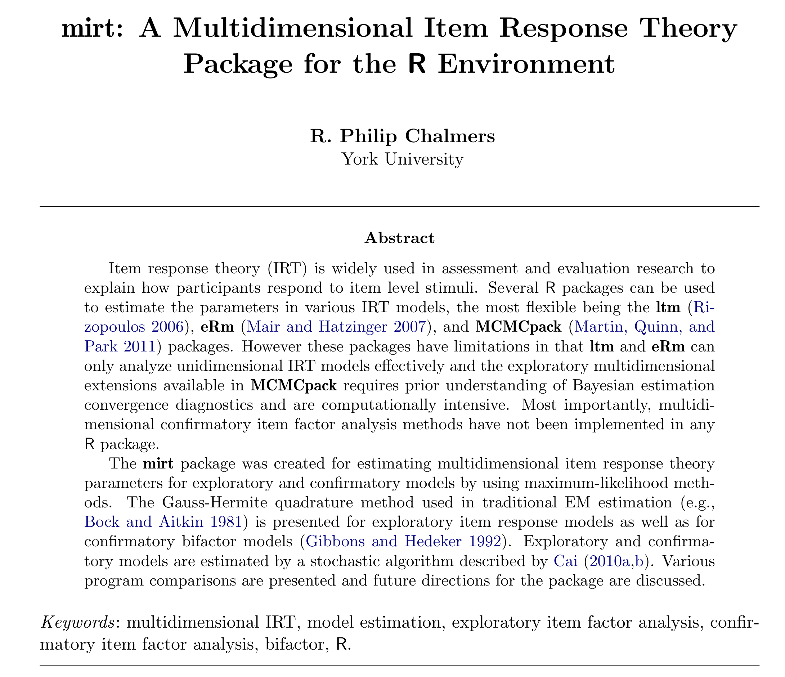
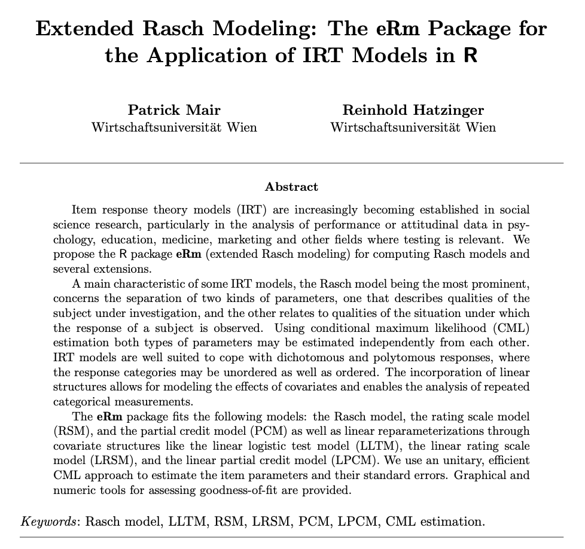

```{r}
#| label: setup
#| include: false
colors <- viridisLite::viridis(5)
dark <- "#23373b"

# probability of solving an item in the 1PL, 2PL and 3PL model
p_1pl <- function(theta, b) 1 / (1 + exp(-(theta - b)))
p_2pl <- function(theta, a, b) 1 / (1 + exp(-a * (theta - b)))
p_3pl <- function(theta, a, b, c) c + (1 - c) / (1 + exp(-a * (theta - b)))
```

## Semesterübersicht {.smaller}

| Nr. | Datum     | Thema                                                        |
|-----|-----------|--------------------------------------------------------------|
| 1   | ab 20.10. | Rechenkompetenzen                                      |
| 2   | ab 27.10. | Gütekriterien I                                |
| 3   | ab 03.11. | Schritte der Testkonstruktion                                |
| 4   | ab 10.11. | Erstellung eines Testentwurfs                             |
|     |           | **Lektürewoche**                   |
| 5   | ab 24.11. | *Diagnostische Rechenkompetenzen I*   |
| 6   | ab 01.12. | Klassische Testtheorie                                       |
| 7   | ab 08.12. | *Item-Response-Theorie*                      |
| 8   | ab 15.12. | Exploratorische Faktorenanalyse I                            |
|     |           | **Weihnachtsferien**           |
| 9   | ab 05.01. | *Exploratorische Faktorenanalyse II*                            |
| 10  | ab 12.01. | Itemanalyse I                                                |
| 11  | ab 19.01. | Itemanalyse II, Itemselektion und Testrevision               |
| 12  | ab 26.01. | *Diagnostische Rechenkompetenzen II*                            |
| 13  | ab 02.02. | Gütekriterien II  |

## Item-Response-Theorie

:::: {.columns}
::: {.column width="60%"}
::: {.callout-note title="Annahme"}
Eine oder mehrere latente Fähigkeiten beeinflussen die Wahrscheinlichkeit, dass ein bestimmtes Testverhalten gezeigt wird.
:::

- Latente Fähigkeit/Eigenschaft nicht beobachtbar
- Testverhalten (Antworten auf die Items) beobachtbar
:::

::: {.column width="40%"}
```{mermaid}
%%| fig-width: 2.2
%%{init: {"htmlLabels": false, "flowchart": {"htmlLabels": false}, "themeVariables": {"fontFamily": "Fira Sans"}, "themeCSS": "background-color: #fafafa;"}}%%
flowchart TD
  classDef step fill:#3B528B,stroke:#3B528B,color:#fff
  classDef done fill:#5DC863,stroke:#5DC863,color:#23373b
  trait["Fähigkeit/Eigenschaft"]
  item1["Item 1"]
  item2["Item 2"]
  item3["Item 3"]
  trait --> item1
  trait --> item2
  trait --> item3
  class trait step
  class item1,item2,item3 done
```
:::
::::

## Item-Response-Theorie

- Erlaubt es, Personen und Items auf einem latenten Kontinuum zu verorten
- Besonderheit: dichotome (oder auch kategorial geordnete) Antworten
- Idee: Lösungswahrscheinlichkeit eines Items ist abhängig von der latenten Merkmalsausprägung einer Person und der Aufgabenschwierigkeit
- Modelle:
  - Rasch-Modell (1PL)
  - Birnbaum-Modell (2PL)
  - 3PL-Modelle, …

# Rasch-Modell

## Rasch-Modell

**Annahmen**

- Eine kontinuierliche latente Variable, die das interessierende Konstrukt repräsentiert
- Erfassung des Konstrukts mithilfe von dichotomen Items
- Schätzung von Personenfähigkeit und Itemschwierigkeit auf einer gemeinsamen Skala

## Rasch-Modell {.nostretch}

```{r}
#| label: fig-latent-continuum
#| echo: false
#| fig-width: 8
#| fig-height: 3.4
#| out-width: "75%"
#| fig-cap: "Latentes Kontinuum mit einer Person und fünf Items [nach @deayala2009, S. 12]"
#| fig-alt: "Waagrechte Achse von -3 bis 3; Person A steht über dem Wert 0, die Items 1 bis 5 stehen unter den Werten -2 bis 2."
par(mar = c(0, 0, 0, 0))
plot.new()
plot.window(xlim = c(-3.6, 3.6), ylim = c(-2.4, 2.4))

# latent continuum with ticks and labels
arrows(-3.5, 0, 3.5, 0, code = 3, length = 0.12, lwd = 2, col = dark)
segments(-3:3, 0, -3:3, 0.15, lwd = 2, col = dark)
text(-3:3, -0.3, labels = -3:3, cex = 1.2, col = dark)

# person A above the continuum
rect(-0.25, 1.25, 0.25, 1.85, col = colors[2], border = NA)
text(0, 1.55, "A", cex = 1.3, col = "white")
arrows(0, 1.2, 0, 0.25, length = 0.1, lwd = 2, col = dark)
text(0, 2.2, "Person", cex = 1.3, col = dark)

# items 1 to 5 below the continuum
item_location <- -2:2
arrows(item_location, -1.3, item_location, -0.55, length = 0.1, lwd = 2, col = dark)
points(item_location, rep(-1.65, 5), pch = 21, cex = 4.5, bg = colors[4], col = colors[4])
text(item_location, -1.65, labels = 1:5, cex = 1.2, col = dark)
text(0, -2.3, "Items", cex = 1.3, col = dark)
```

## Rasch-Modell

**Modellgleichung**

$$
P(u_{ij} = 1 \mid \theta_i, \beta_j) = \frac{e^{\theta_i - \beta_j}}{1 + e^{\theta_i - \beta_j}}
$$ {#eq-rasch}

- $\theta$: latente Variable (Fähigkeit/Eigenschaft)
- $\beta$: Itemschwierigkeit

Modelliert wird die Wahrscheinlichkeit, dass Person $i$ mit Fähigkeit $\theta_i$ ein Item $j$ mit der Schwierigkeit $\beta_j$ löst.

## Rasch-Modell

:::: {.columns}
::: {.column width="40%"}
**Item Characteristic Curve (ICC)**

Verlauf der Lösungswahrscheinlichkeit für ein Item in Abhängigkeit von der Personenfähigkeit
:::

::: {.column width="60%"}
```{r}
#| label: icc
#| echo: false
#| fig-width: 5
#| fig-height: 3.5
#| out-width: "100%"
#| fig-alt: "S-förmige Kurve der Lösungswahrscheinlichkeit eines Items mit der Schwierigkeit 0 für Fähigkeiten von -6 bis 6"
theta <- seq(-6, 6, length.out = 300)
par(mar = c(4, 4.5, 0.5, 0.5))
plot(theta, p_1pl(theta, 0),
  type = "l", lwd = 3, col = colors[2], las = 1, ylim = c(0, 1),
  xlab = expression(theta), ylab = expression(P(theta))
)
```
:::
::::

## Rasch-Modell

**Annahmen und Eigenschaften**

1. Suffiziente Statistiken
2. Eindimensionalität
3. Lokale stochastische Unabhängigkeit
4. Spezifische Objektivität

## Rasch-Modell

**Normierung und Messniveau**

- Skala der Personenfähigkeiten und Itemschwierigkeiten ist eine latente Skala $\rightarrow$ Skala besitzt keinen natürlichen Ursprung
- Bei der Normierung wird der Nullpunkt festgelegt

:::: {.columns}
::: {.column width="50%"}
**Summennormierung**

Summe der Itemschwierigkeiten als Nullpunkt:

$$
\sum_{j=1}^{m} \beta_j = 0
$$ {#eq-sum-norm}
:::

::: {.column width="50%"}
**Mittelpunktsnormierung**

Mittelwert der Personenparameter als Nullpunkt:

$$
\overline{\theta} = \frac{1}{N} \sum_{i=1}^{N} \theta_i = 0
$$ {#eq-mean-norm}
:::
::::

## 1PL-, 2PL- und 3PL-Modell {.nostretch}

```{r}
#| label: fig-irt-models
#| echo: false
#| fig-width: 9
#| fig-height: 3.4
#| out-width: "100%"
#| fig-cap: "Itemcharakteristische Kurven im 1PL-, 2PL- und 3PL-Modell"
#| fig-alt: "Drei Panels mit je drei Kurven: im 1PL-Modell verschoben durch die Schwierigkeit, im 2PL-Modell unterschiedlich steil durch die Diskrimination, im 3PL-Modell mit angehobener Untergrenze durch den Rateparameter"
theta <- seq(-4, 4, length.out = 300)
model_colors <- colors[c(1, 3, 4)]

# one panel with three curves and a legend
plot_panel <- function(curves, title, labels) {
  plot(theta, curves[[1]],
    type = "n", las = 1, ylim = c(0, 1), main = title,
    xlab = expression(theta), ylab = expression(P(theta))
  )
  for (k in 1:3) lines(theta, curves[[k]], lwd = 2.5, col = model_colors[k])
  legend("bottomright",
    legend = labels, col = model_colors, lwd = 2.5, cex = 0.9, bty = "n"
  )
}

par(mfrow = c(1, 3), mar = c(4, 4.5, 2.5, 0.5))
plot_panel(
  list(p_1pl(theta, -1.5), p_1pl(theta, 0), p_1pl(theta, 1.5)),
  "1PL (Rasch)",
  expression(beta == -1.5, beta == 0, beta == 1.5)
)
plot_panel(
  list(p_2pl(theta, 0.5, 0), p_2pl(theta, 1, 0), p_2pl(theta, 2, 0)),
  "2PL (Birnbaum)",
  expression(a == 0.5, a == 1.0, a == 2.0)
)
plot_panel(
  list(p_3pl(theta, 1, 0, 0), p_3pl(theta, 1, 0, 0.1), p_3pl(theta, 1, 0, 0.25)),
  "3PL",
  expression(c == 0, c == 0.10, c == 0.25)
)
```

## 1PL-, 2PL- und 3PL-Modell

:::: {.columns}
::: {.column width="30%"}
**1PL:** nur Schwierigkeit $\beta$

$$
P(\theta) = \frac{1}{1 + e^{-(\theta - \beta)}}
$$
:::

::: {.column width="32%"}
**2PL:** + Diskrimination $a$

$$
P(\theta) = \frac{1}{1 + e^{-a(\theta - \beta)}}
$$
:::

::: {.column width="38%"}
**3PL:** + Rateparameter $c$

$$
P(\theta) = c + \frac{1 - c}{1 + e^{-a(\theta - \beta)}}
$$
:::
::::

# Anwendung: IRT in R

## R-Pakete für IRT

:::: {.columns}
::: {.column width="50%"}
`library(mirt)`

{width="65%" fig-alt="Titelseite des Artikels zum R-Paket mirt"}

[@chalmers2012]
:::

::: {.column width="50%"}
`library(eRm)`

{width="60%" fig-alt="Titelseite des Artikels zum R-Paket eRm"}

[@mair2007]
:::
::::

## library(mirt)

**Zentrale Funktion:** `mirt()`

**Argumente**

- `data`: `matrix` oder `data.frame`, bei der jede Zeile die Antworten einer Person repräsentiert
- `model`: Angabe der Anzahl der Faktoren oder eines mit `mirt.model()` definierten Objekts für komplexere Ladungsmuster
- `itemtype`: Auswahl des IRT-Modells, z. B. „Rasch“, „2PL“ oder „3PL“ (Default ist 2PL)

## Spickzettel – Rasch-Modell in R

```{r}
#| label: cheatsheet-fit
#| eval: false
#| echo: true
# load the mirt package
library(mirt)

# Rasch model
rm1 <- mirt(data = dat, model = 1, itemtype = "Rasch")
#                   |           |                |
#               data set    number of       model type
#                       latent variables
```

## Spickzettel – Rasch-Modell in R

```{r}
#| label: cheatsheet-results
#| eval: false
#| echo: true
# item difficulties
coef(object = rm1, simplify = TRUE, IRTpars = TRUE)$items

# person parameters
rm1.thetas <- fscores(object = rm1, method = "EAP")

# plot the item characteristic curve (ICC)
itemplot(object = rm1, item = 1)
```

# Danke & bis nächste Woche! {.unlisted}

# Literaturverzeichnis

## Literatur

::: {#refs}
:::
